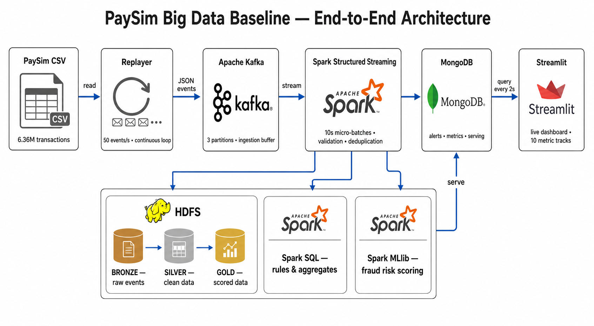

# PaySim Big Data Baseline

Big Data baseline end-to-end:



## Yêu cầu

- Docker Desktop, tối thiểu 6 GB RAM và 6 GB trống.
- Internet trong lần chạy đầu để tải image và dataset.

## Khởi động

```bash
git clone https://github.com/thuanbui1309/paysim-big-data-baseline.git
cd paysim-big-data-baseline
```

macOS/Linux:

```bash
chmod +x start.sh stop.sh reset.sh scripts/prepare-data.sh
./start.sh
```

Windows:

```bat
start.bat
```

Dataset được tải và kiểm SHA-256 tự động nếu `data/paysim.csv` chưa có.

## Giao diện

- Dashboard: <http://127.0.0.1:8501>
- HDFS: <http://127.0.0.1:9870>
- Spark: <http://127.0.0.1:4040>
- Kafka: `localhost:29092`
- MongoDB: `localhost:27017`

## Vận hành

macOS/Linux:

```bash
./stop.sh
./start.sh
./reset.sh
docker compose ps
docker compose logs -f spark replayer streamlit
```

Windows:

```bat
stop.bat
start.bat
reset.bat
docker compose ps
docker compose logs -f spark replayer streamlit
```

`reset.sh` và `reset.bat` xóa các volume Kafka, HDFS và MongoDB của riêng
baseline, nhưng không xóa `data/paysim.csv`. Dùng lệnh reset khi HDFS báo
`SafeModeException` hoặc corrupt blocks sau một lần dừng không sạch.

Mặc định hệ thống phát liên tục 50 events/s, xử lý theo micro-batch 10 giây và
lặp lại dataset sau 6.362.620 giao dịch. Copy `.env.example` thành `.env` để đổi
cấu hình hoặc bật fault injection.

Nhãn PaySim không đi vào Kafka. Replayer lưu nhãn trong MongoDB `ground_truth`;
evaluator chỉ đọc nhãn sau khi Spark hoàn tất scoring.

Đây là deployment single-node dành cho thực hành.
