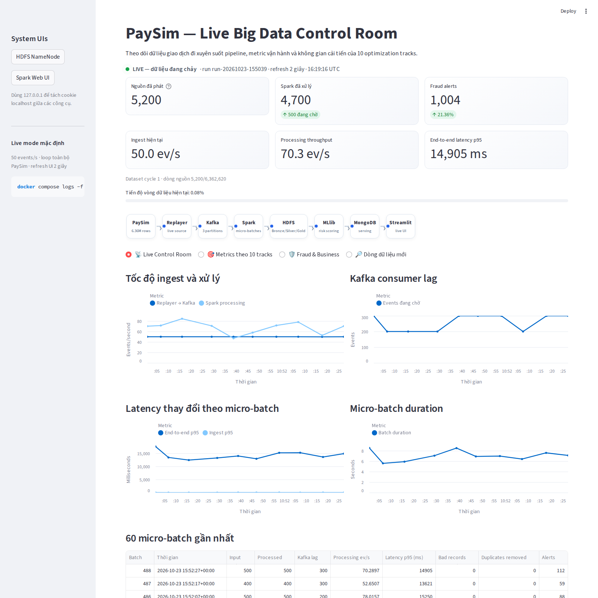
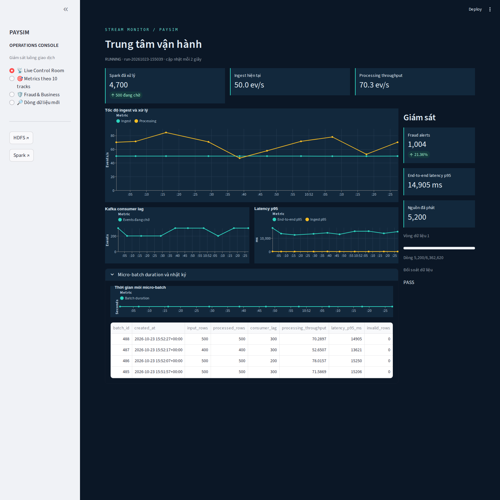
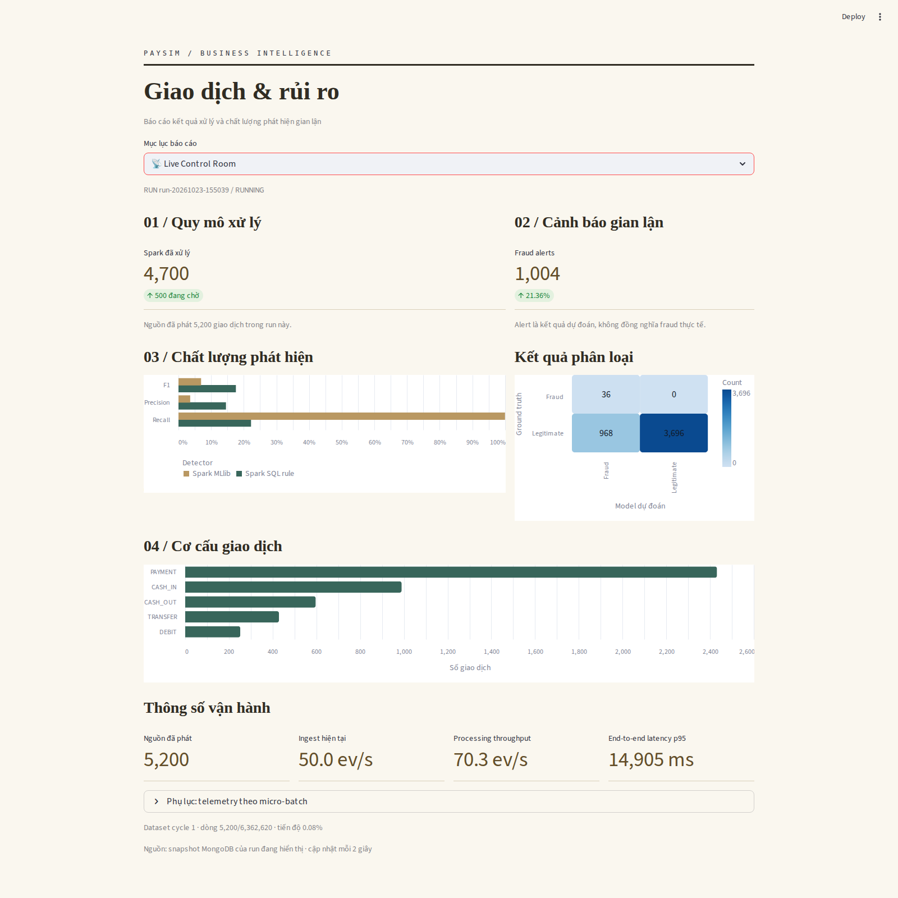
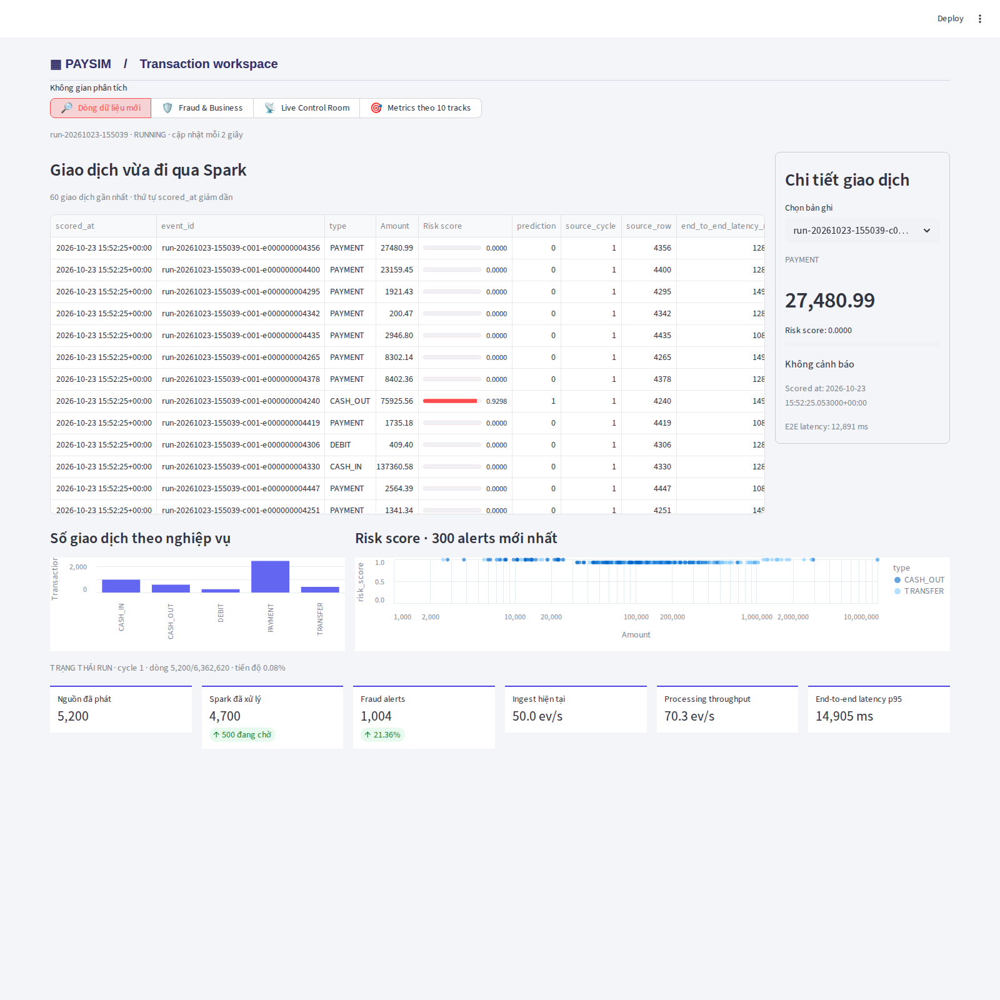

# HƯỚNG DẪN ĐỌC VÀ CẢI TIẾN GIAO DIỆN DASHBOARD PAYSIM

## 1. Phạm vi

Trong buổi này, chọn giao diện tại [dashboard/app.py](../dashboard/app.py), rồi đọc các vùng BEFORE/AFTER trong ba file `view_*.py`. Chỉ thay đổi cách trình bày; giữ nguyên truy vấn, công thức, model và kết quả pipeline.

`app.py` đã chuẩn bị sẵn bốn lựa chọn:

| Block | Giao diện | Trạng thái ban đầu |
|---|---|---|
| `BEFORE Start — 9` → `BEFORE END — 9` | Control Room gốc | Đang comment |
| `AFTER Start — 9A` → `AFTER END — 9A` | Trung tâm vận hành | **Đang chạy** |
| `AFTER Start — 9B` → `AFTER END — 9B` | Báo cáo giao dịch và rủi ro | Đang comment |
| `AFTER Start — 9C` → `AFTER END — 9C` | Không gian phân tích giao dịch | Đang comment |

**Chỉ bật một block trong bốn block trên.** Comment dòng chọn đang chạy rồi bỏ comment dòng chọn muốn thử. Giữ nguyên các dòng chú thích và marker Start/END, `from dashboard_core import render` và `render(view)`.

Ba AFTER là ba phương án thay thế nhau, **không phải ba bước tối ưu để bật cùng lúc**. Để lấy mốc ban đầu, tắt AFTER 9A và bật BEFORE 9 trước.

Mục tiêu:

- hiểu dashboard lấy dữ liệu và trình bày kết quả ở đâu;
- thử bốn giao diện trên cùng dữ liệu;
- giải thích năm thay đổi của mỗi AFTER bằng mục đích sử dụng;
- kiểm tra số liệu giữ nguyên và nhận diện đánh đổi giữa các bố cục.

---

## 2. Dashboard làm gì trong pipeline?

| Nội dung đã học | Vai trò trong PaySim | Vị trí code |
|---|---|---|
| Nguồn dữ liệu | Đọc run, telemetry, evaluation, giao dịch và alerts từ MongoDB | `load_snapshot()` trong `dashboard_core.py` |
| Metric | Tính và định dạng số liệu từ cùng snapshot | Các hàm dùng chung trong `dashboard_core.py` |
| Điều hướng | Chuyển giữa bốn trang nội dung | `PAGES`, `render_page()` và `setup()` của từng view |
| Bố cục | Chọn vị trí KPI, bảng, biểu đồ và phần chi tiết | `render()` của từng view |
| Làm mới | Cập nhật phần dữ liệu mỗi 2 giây | `live_dashboard()` trong `dashboard_core.py` |

### Luồng tổng quan

```text
Kafka → Spark → HDFS / MongoDB
                            ↓
                   load_snapshot()
                            ↓
                 Cùng dữ liệu, cùng công thức
                            ↓
              app.py chọn đúng một giao diện
                  ├─ BEFORE 9: Control Room
                  ├─ AFTER 9A: Vận hành
                  ├─ AFTER 9B: Báo cáo
                  └─ AFTER 9C: Giao dịch
```

Dashboard đọc kết quả đã có. Đổi giao diện không train lại model, không chấm điểm lại giao dịch và không thay ngưỡng cảnh báo.

---

## 3. Cách đọc code dashboard

Không cần đọc từ đầu tới cuối. Đi theo thứ tự:

1. [app.py](../dashboard/app.py): xác định dòng chọn giao diện đang bật.
2. [dashboard_core.py](../dashboard/dashboard_core.py), hàm `render()`: cấu hình trang và gọi vùng dữ liệu tự làm mới.
3. `live_dashboard()` và `load_snapshot()`: xác định snapshot dùng chung trước khi chuyển sang phần hiển thị.
4. `setup()` và `render()` trong file view đang chọn: xem cách tổ chức điều hướng và nội dung.
5. Năm vùng BEFORE/AFTER trong file view: đối chiếu từng quyết định trình bày.
6. `render_page()` trong lõi: xem nội dung các trang chuyên sâu được dùng lại.

### Các file cần đối chiếu

| File | Vai trò | Marker |
|---|---|---|
| [view_operations.py](../dashboard/view_operations.py) | Trung tâm vận hành | `9A.1` → `9A.5` |
| [view_report.py](../dashboard/view_report.py) | Báo cáo giao dịch và rủi ro | `9B.1` → `9B.5` |
| [view_studio.py](../dashboard/view_studio.py) | Không gian phân tích giao dịch | `9C.1` → `9C.5` |

Mỗi file có **5 cặp marker BEFORE/AFTER**. BEFORE trong các file view là đoạn tham chiếu giải thích phần được thay thế; không bật riêng các đoạn đó. Muốn chạy BEFORE hoàn chỉnh, chọn `view = None` tại `app.py`.

---

## 4. Metric và tiêu chí cần theo dõi

| Nội dung trên dashboard | Cách đối chiếu | Điều kiện |
|---|---|---|
| Nguồn đã phát / Spark đã xử lý / lag | So số lượng và phần chênh lệch | Cùng snapshot |
| Fraud alerts / alert rate | So số cảnh báo và tỷ lệ | Không đổi model hoặc ngưỡng |
| Ingest / processing throughput | So giá trị và đơn vị events/s | Cùng lần đo |
| End-to-end latency p95 | So giá trị và đơn vị ms | Cùng lần đo |
| Precision / Recall / F1 / confusion matrix | So model với model, rule với rule | Cùng evaluation |
| Bảng giao dịch / alerts | So nội dung và giới hạn bản ghi | Tối đa 60 giao dịch, 300 alerts mới nhất |
| Khả năng đọc | Tìm KPI, đọc biểu đồ, mở chi tiết | Cùng tác vụ và kích thước màn hình |
| Điều hướng | Mở đủ bốn trang, kiểm tra exception | Thử cả desktop và mobile |

**Điều kiện kết quả hợp lệ:**

- giữ nguyên run, truy vấn, công thức và giới hạn tối đa 60 micro-batch;
- giữ đủ bốn trang: Live Control Room, 10 tracks, Fraud & Business và dòng dữ liệu mới;
- giữ refresh 2 giây; không biến metric `Benchmark-only` thành số giả;
- phân biệt chất lượng giao diện với hiệu năng hoặc chất lượng phát hiện của pipeline.

Hai ảnh live chụp khác thời điểm có thể có số khác nhau. Muốn đối chiếu bằng tuyệt đối, dùng cùng snapshot hoặc tạm dừng các tiến trình ghi sau khi batch hoàn tất. Query latency và freshness phụ thuộc thời điểm mở UI, không dùng để chứng minh số liệu bằng nhau.

---

## 5. BEFORE — Control Room làm mốc

### Điểm cần kiểm chứng

Giao diện gốc tập trung tiêu đề, sáu KPI và thông tin pipeline trước các trang nội dung. Bố cục này làm mốc để xem việc đổi thứ tự đọc có giúp thực hiện một tác vụ cụ thể hay không.

### Code khi bật BEFORE 9

Trong `app.py`, chỉ bật dòng chọn sau:

```python
view = None
```

Comment cả ba dòng `import view_... as view`. Giữ nguyên lời gọi `render(view)` ở cuối file.

### Kết quả tham khảo



### Cách thử các AFTER

Chạy BEFORE trước, ghi run ID và sáu KPI chung. Sau đó chọn lần lượt 9A, 9B, 9C; mỗi lần chỉ build lại dashboard. Ba trang mở đầu thay đổi mục đích và thứ tự đọc; các trang chuyên sâu tiếp tục dùng nội dung gốc trong khung của từng phiên bản.

---

## 6. AFTER 9A — Trung tâm vận hành

### Giả thuyết

Đặt tốc độ xử lý ở trung tâm và cảnh báo ở cột bên cạnh có thể giúp người theo dõi pipeline đối chiếu nhanh throughput, lag và latency.

### Code khi bật AFTER 9A

```python
import view_operations as view
```

Tắt BEFORE 9 và các AFTER còn lại. Đọc năm vùng trong [view_operations.py](../dashboard/view_operations.py):

| Block | Thay đổi hiển thị | Mục đích |
|---|---|---|
| `9A.1` | Nền tối, màn hình rộng, điều hướng sidebar | Dành phần chính cho giám sát |
| `9A.2` | Ba KPI tốc độ/xử lý phía trên | Quét nhanh tình trạng pipeline |
| `9A.3` | Throughput lớn; lag và latency bên dưới | Đọc các lần đo cạnh nhau |
| `9A.4` | Cột cảnh báo, latency và tiến độ bên phải | Đối chiếu với biểu đồ chính |
| `9A.5` | Nhật ký và duration của batch ở cuối | Tra cứu chi tiết sau khi thấy bất thường |

### Kết quả tham khảo



Sáu KPI chung khớp BEFORE trên snapshot kiểm thử. Bố cục ưu tiên màn hình rộng; trên điện thoại các cột xếp lại và cần cuộn nhiều hơn. Chưa đo thời gian người dùng tìm thông tin nên không kết luận bố cục này luôn nhanh hơn.

---

## 7. AFTER 9B — Báo cáo giao dịch và rủi ro

### Giả thuyết

Đưa kết quả nghiệp vụ và chất lượng phát hiện lên trước có thể giúp người đọc báo cáo hiểu quy mô xử lý, số cảnh báo và đánh đổi của model theo trình tự.

### Code khi bật AFTER 9B

```python
import view_report as view
```

Tắt AFTER 9A trước khi bật 9B. Đọc năm vùng trong [view_report.py](../dashboard/view_report.py):

| Block | Thay đổi hiển thị | Mục đích |
|---|---|---|
| `9B.1` | Khổ đọc 1120px, nền kem, chữ serif, mục lục | Tạo bố cục báo cáo đọc tuần tự |
| `9B.2` | Hai kết quả xử lý/cảnh báo kèm diễn giải | Nêu kết quả chính trước |
| `9B.3` | Thanh ngang precision/recall/F1 của model và rule | So chất lượng phát hiện |
| `9B.4` | Cơ cấu giao dịch và confusion matrix | Giải thích thành phần dữ liệu và kết quả phân loại |
| `9B.5` | Thông số vận hành và phụ lục ở cuối | Giữ chi tiết mà không chiếm phần mở đầu |

### Kết quả tham khảo



Sáu KPI chung khớp BEFORE; biểu đồ dùng lại precision/recall/F1 từ công thức gốc. Telemetry nằm trong phụ lục mở rộng nên cần thêm thao tác khi muốn giám sát batch liên tục.

---

## 8. AFTER 9C — Không gian phân tích giao dịch

### Giả thuyết

Mở thẳng bảng giao dịch và đặt chi tiết bên cạnh có thể giúp người phân tích đọc một bản ghi mà vẫn giữ được ngữ cảnh của danh sách.

### Code khi bật AFTER 9C

```python
import view_studio as view
```

Đọc năm vùng trong [view_studio.py](../dashboard/view_studio.py):

| Block | Thay đổi hiển thị | Mục đích |
|---|---|---|
| `9C.1` | Thanh công cụ gọn, trang mặc định là giao dịch | Đi thẳng vào dữ liệu cần đọc |
| `9C.2` | Bảng 60 giao dịch chiếm vùng làm việc chính | Ưu tiên đối chiếu bản ghi |
| `9C.3` | Bộ chọn và khung chi tiết bên phải | Xem số tiền, risk score, prediction và thời điểm |
| `9C.4` | Biểu đồ loại giao dịch và risk score dưới bảng | Đối chiếu giao dịch với phân bố chung |
| `9C.5` | Sáu KPI chung ở cuối trang | Giữ trạng thái run mà không lấn vùng bảng |

### Kết quả tham khảo



Bộ chọn chi tiết chỉ đọc bản ghi đã tải; không ghi dữ liệu hoặc chấm điểm lại. Sáu KPI chung khớp BEFORE. Bảng nhiều cột cần cuộn ngang trên màn hình nhỏ.

### So sánh cả bốn giao diện — cùng snapshot

| Giao diện | Nội dung đọc trước | Kiểu bố cục | Đánh đổi |
|---|---|---|---|
| BEFORE 9 | KPI và pipeline | Control Room tổng quan | Cần chuyển trang để đi sâu |
| AFTER 9A | Throughput, lag, latency | Biểu đồ lớn và cột giám sát | Nhiều vùng cần cuộn trên mobile |
| AFTER 9B | Kết quả và chất lượng phát hiện | Báo cáo theo khổ đọc | Telemetry nằm trong phụ lục |
| AFTER 9C | Giao dịch và chi tiết | Bảng và khung chi tiết | Bảng rộng cần cuộn ngang |

**Không có “bản kết hợp ba AFTER”.** Chọn theo tác vụ cần phục vụ, rồi kiểm tra các đánh đổi còn lại. Không đánh giá tốt hơn chỉ vì màu khác.

---

## 9. Quy trình thực hành trên dashboard

```text
Bật BEFORE → ghi số liệu và chụp giao diện
           → tắt BEFORE, bật một AFTER
           → build lại dashboard → mở cùng dữ liệu
           → so kết quả, bố cục và điều kiện hợp lệ
```

### Chuẩn bị cùng điều kiện

Khởi động toàn hệ thống lần đầu bằng `./start.sh` hoặc `start.bat` theo README. Giữ nguyên backend, model, threshold và cấu hình tài nguyên. Dùng cùng snapshot khi cần so số liệu tuyệt đối; cách tạo và chụp snapshot nằm trong [biên bản kiểm thử](06_Kiem_Thu_Dashboard_Va_Khoi_Dong.md).

### Thực hiện từng lượt

1. Trong `app.py`, comment dòng chọn đang bật và bỏ comment đúng dòng chọn muốn chạy. Không bỏ dấu `#` của marker hoặc lời giải thích. Nếu bật nhiều import, Python dùng import cuối cùng; đây là cấu hình sai bài thực hành.
2. Tại thư mục gốc dự án, build lại riêng dashboard:

   ```bash
   docker compose -f docker-compose.yml up -d --build --no-deps streamlit
   ```

   Nếu đang chạy chế độ nhẹ, dùng cùng overlay:

   ```bash
   docker compose -f docker-compose.yml -f docker-compose.low-memory.yml up -d --build --no-deps streamlit
   ```

   Hai lệnh dùng được trong PowerShell và terminal macOS/Linux. File Python được COPY vào image nên **chỉ refresh browser hoặc restart container sẽ không nhận code vừa sửa**.

3. Mở <http://127.0.0.1:8501>, refresh và kiểm tra đúng bố cục đã chọn.
4. Mở đủ bốn trang. So sáu KPI, model/rule, confusion matrix và dữ liệu giao dịch trên cùng snapshot.
5. Xác định năm vùng thay đổi; chụp desktop/mobile và ghi lợi ích, đánh đổi của từng phiên bản.
6. Đổi sang phiên bản tiếp theo và lặp lại. Không thay công thức trong `dashboard_core.py`.
7. Đề xuất bố cục riêng; nêu tác vụ được cải thiện và ít nhất một tình huống khó đọc hơn.

### Bảng báo cáo

| Nội dung | BEFORE 9 | AFTER 9A | AFTER 9B | AFTER 9C |
|---|---|---|---|---|
| RUN_ID / snapshot | | | | |
| Tác vụ cần thực hiện | | | | |
| Nguồn đã phát / đã xử lý / lag | | | | |
| Alerts / alert rate | | | | |
| Ingest / processing throughput | | | | |
| End-to-end latency p95 | | | | |
| Precision / Recall / F1 có giữ nguyên? | | | | |
| Đủ bốn trang, không exception? | | | | |
| Năm vùng thay đổi | — | | | |
| Ảnh desktop / mobile | | | | |
| Khó đọc / cần thêm thao tác ở đâu? | | | | |
| Phù hợp tác vụ đã chọn? | | | | |

---

## 10. Điều kiện của kết quả tham khảo

- Ảnh gốc chụp bằng Chromium/Playwright: desktop 1600 × 1600, mobile 390 × 844. Ảnh viewport không bao gồm toàn bộ phần cần cuộn.
- Dữ liệu lấy từ pipeline thật, run `run-20261023-155039`, rồi sao chép vào database evidence riêng; không ghi đè nguồn.
- Cùng snapshot: nguồn phát **5.200**, xử lý **4.700**, lag **500**, alerts **1.004**, alert rate **21,36%**, ingest **50,0 events/s**, processing **70,3 events/s**, latency p95 **14.905 ms**.
- Nhãn RUNNING/LIVE trong ảnh là trạng thái được sao chép; database evidence không tiếp tục nhận giao dịch. Freshness và thời gian query thay đổi theo thời điểm mở trang.
- AppTest sau khi đổi bố cục: **7 test đạt**, gồm đối chiếu sáu KPI chung của ba AFTER trên cả bốn trang và các trường hợp dữ liệu rỗng.
- Browser đã mở **16 trang desktop và 4 mobile**, không exception; sáu KPI chung khớp ở **12/12 cặp BEFORE/AFTER**.
- Chưa đo khả năng sử dụng với người học, không kết luận tăng tốc pipeline hoặc giảm thời gian thao tác từ các ảnh này.

### Tự chạy kiểm thử

Dùng Python 3.11 trở lên và môi trường kiểm thử riêng, không sửa Python hệ thống:

```bash
python -m venv .venv
# macOS/Linux:
source .venv/bin/activate
# Windows PowerShell, thay lệnh activate ở trên bằng:
# .\.venv\Scripts\Activate.ps1
pip install -r dashboard/requirements.txt -r tests/requirements.txt
python -m pytest -q tests
```

`test_dashboard.py` dùng dữ liệu cố định trong Mongo giả để đối chiếu sáu KPI chung trên đủ bốn trang, đồng thời kiểm tra trạng thái rỗng. Đây là kiểm thử UI, không thay thế pipeline end-to-end. `test_windows_launcher.py` chạy PowerShell thật khi có sẵn, nhưng dùng Docker giả để tạo lỗi có kiểm soát.

Streamlit được khóa ở 1.50.0, Altair ở 5.5.0. Bảng dùng chiều rộng mặc định và chart dùng mặc định của API phiên bản này; tham khảo [dataframe](https://docs.streamlit.io/1.50.0/develop/api-reference/data/st.dataframe) và [Altair chart](https://docs.streamlit.io/1.50.0/develop/api-reference/charts/st.altair_chart).

### Evidence gốc

- [Biên bản kiểm thử và toàn bộ ảnh](06_Kiem_Thu_Dashboard_Va_Khoi_Dong.md).
- [Snapshot và metadata](evidence/dashboard-ui/snapshot.json).
- [Đối chiếu KPI trên snapshot thật](evidence/dashboard-ui/browser-equivalence.json).
- [Log kiểm thử UI sau khi đổi bố cục](evidence/dashboard-ui/ui-redesign-tests.txt).

Phân biệt fixture trong unit test với dữ liệu pipeline thật trong ảnh. Phần điều tra launcher và giới hạn kiểm thử hệ điều hành được ghi riêng trong biên bản.

Kết luận bài thực hành phải trả lời: giao diện nào phù hợp **tác vụ mục tiêu**, phải trả giá bằng gì, và số liệu có được giữ nguyên khi đổi cách trình bày không?
